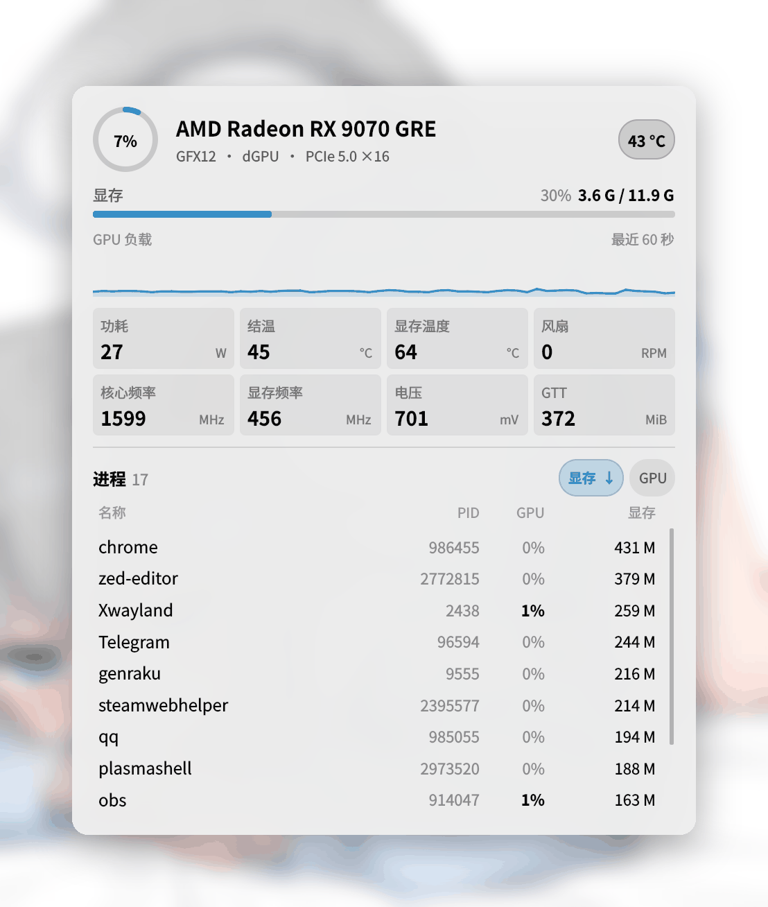

<div align="center">
  <h1 align="center">kde-amdgpu-top</h1>
  <p align="center">A KDE Plasma 6 panel monitor for AMD GPU load / VRAM, with sensor details and per-process usage</p>
  <p align="center">English | <a href="README.md">中文</a></p>

  <a href="https://github.com/haoyn231/kde-amdgpu-top/releases/latest"></a>
  <a href="./LICENSE"></a>
  
  
  
  
  <br>
  <a href="https://github.com/haoyn231/kde-amdgpu-top/stargazers"></a>
</div>

---

<p align="center">
  
</p>

<p align="center"><sub>Load ring, VRAM bar, 60-second history, eight sensor tiles and the process list sorted by VRAM</sub></p>

A KDE Plasma 6 panel widget (Plasmoid) that previews AMD GPU load and VRAM usage in the panel, and opens a popup with sensor details and per-process VRAM usage, sortable by VRAM or GPU usage. All data comes from [`amdgpu_top`](https://github.com/Umio-Yasuno/amdgpu_top), and every color follows the system light/dark color scheme.

Inspired by [kde-perfmon](https://github.com/haoyn231/kde-perfmon) (`CompactRepresentation`, process-list interaction and data semantics) and by the list refresh strategy of [DankMaterialShell (DMS)](https://github.com/AvengeMedia/DankMaterialShell). Unlike kde-perfmon there is no C++ plugin to compile: the panel and popup are plain QML, and the collection is done by a Python script.

## Features

- Panel shows "icon + GPU load + VRAM usage"; VRAM can be shown as a percentage or as a real size; load turns amber at ≥70% and red at ≥90%
- Click the GPU number to open the process list sorted by GPU usage; click the VRAM number to open it sorted by VRAM; click again to close
- Popup header: load ring, GPU name, chip / type / PCIe link, and an edge-temperature badge
- VRAM bar: used / total plus percentage, switching to a warning color near the limit
- History: the last 60 seconds of GFX load, accumulated by the collector, so the full curve is there as soon as the popup opens
- Sensors: power, junction temperature, memory temperature, fan speed, core clock, memory clock, voltage, GTT
- Process rows: name, PID, GPU usage, VRAM usage; `VRAM` / `GPU` sort buttons, click the active one again to flip the direction
- Click a row to expand the full command line, `PPID`, GTT, media-engine usage and the share of total VRAM
- The list refreshes live only while it is scrolled to the top; scrolling down freezes it into a static table and shows `Paused · back to top`, which scrolls back and resumes
- Closing the popup stops rebuilding the process list: the collector only writes snapshots, keeping the cost minimal
- Everything is bound to `Kirigami.Theme`, so light/dark and accent changes apply instantly

## Installation (KDE Plasma 6)

### Option 1: install from the release (recommended)

The release archive is **plain QML plus a Python script** — there is no binary to compile, so no build tools are required.

1. Requirements: KDE Plasma 6 (Qt 6.5+), [`amdgpu_top`](https://github.com/Umio-Yasuno/amdgpu_top) (≥ 0.9) and `python3` (standard library only). The published package is tested on Arch Linux / Plasma 6.8.3 / Qt 6.12 / amdgpu_top 0.11.5.
2. Download `kde-amdgpu-top-vX.Y.Z.tar.gz` and the matching `.sha256` file from [Releases](https://github.com/haoyn231/kde-amdgpu-top/releases), then verify:
   ```bash
   sha256sum -c kde-amdgpu-top-v0.1.1.tar.gz.sha256
   ```
3. Extract it into your user Plasma widget directory:
   ```bash
   mkdir -p ~/.local/share/plasma/plasmoids
   tar -xzf kde-amdgpu-top-v0.1.1.tar.gz -C ~/.local/share/plasma/plasmoids
   ```
   You should end up with:
   ```
   ~/.local/share/plasma/plasmoids/org.hao.amdgputop/metadata.json
   ~/.local/share/plasma/plasmoids/org.hao.amdgputop/contents/scripts/amdgpu-topd.py
   ~/.local/share/plasma/plasmoids/org.hao.amdgputop/contents/ui/main.qml
   ```
   The collector script must stay executable; restore the bit if your extraction lost it:
   ```bash
   chmod +x ~/.local/share/plasma/plasmoids/org.hao.amdgputop/contents/scripts/amdgpu-topd.py
   ```
4. Reload Plasma (usually only needed after an upgrade):
   ```bash
   systemctl --user restart plasma-plasmashell.service
   ```
   Logging out and back in also works.
5. Add the widget: right-click the panel → **Enter Edit Mode** (or **Add Widgets**) → search for **AMD GPU Monitor** / **AMD GPU 监视器** → drag it onto the panel.
6. Click the GPU or VRAM number in the panel to open the popup.

If the popup says "amdgpu_top not found", install it first (Arch):

```bash
sudo pacman -S amdgpu_top
```

Uninstall:
```bash
rm -rf ~/.local/share/plasma/plasmoids/org.hao.amdgputop
systemctl --user restart plasma-plasmashell.service
```

### Option 2: install from source

Dependencies (Arch Linux):

```bash
sudo pacman -S --needed plasma-desktop amdgpu_top python
```

Install for the current user:

```bash
git clone https://github.com/haoyn231/kde-amdgpu-top.git
cd kde-amdgpu-top
./install.sh
systemctl --user restart plasma-plasmashell.service
```

For development, install as a symlink so QML edits take effect after a plasmashell restart:

```bash
./install.sh --symlink
```

Then follow step 5 above to add the widget to your panel.

## Usage

- The two numbers in the panel are the GPU load and the VRAM usage.
- Clicking the GPU number opens the popup sorted by GPU usage; clicking the VRAM number opens it sorted by VRAM.
- Click the numbers again to close the popup.
- To move it: right-click the panel → enter edit mode → drag it (the item reserves its own slot and no longer overlaps the clock or tray).
- Inside the popup:
  - click `VRAM` / `GPU` to change the sort column;
  - click the active column again to flip ascending / descending;
  - the wheel and touchpad both scroll the process list.
- Live refresh only applies at the very top of the list:
  - at the top it refreshes every second;
  - scrolling down freezes the table and shows `Paused · back to top`, while the summary and sensors keep updating;
  - clicking that hint scrolls back to the top and resumes live refresh;
  - changing the sort column while frozen also returns to the top and resumes.
- Click a process row to expand / collapse:
  - the expanded row shows the full command line, `PPID`, GTT, media-engine usage and the share of total VRAM;
  - if the process already exited, a hint is shown instead of the command line.
- Right-click the widget → Configure to change the refresh interval, how VRAM is displayed, how many processes are listed, the default sort order and which metrics appear in the panel.

## Data semantics

Everything comes from the `-J` output of `amdgpu_top`; the UI only reads a ~5 KB snapshot:

| Value in the UI | Source field | Notes |
| --- | --- | --- |
| GPU load | `gpu_activity.GFX` | Kernel `gpu_busy_percent`, not a performance counter |
| VRAM usage | `VRAM.Total VRAM Usage` / `Total VRAM` | MiB, as reported by the driver |
| Memory / junction temperature | `Sensors.Memory Temperature` / `Junction Temperature` | Some ASICs lack these sensors; missing values show `—` |
| Power | `Sensors.Average Power` | Average board power |
| Core / memory clock | `Sensors.GFX_SCLK` / `GFX_MCLK` | Current clocks, not peaks |
| Voltage | `Sensors.VDDGFX` | mV |
| GTT | `VRAM.Total GTT Usage` | System memory used by the GPU (important on APUs) |
| Process VRAM | `fdinfo.<pid>.usage.VRAM` | Resident VRAM of that process |
| Process GPU usage | `fdinfo.<pid>.usage.GFX` | Per-process engine utilization |

Sorting follows kde-perfmon: switching columns starts descending, clicking the active column flips the direction, and equal values fall back to ascending PID.

### Refresh and freezing

- The collector compresses each frame into a ~5 KB snapshot once per second and atomically replaces `$XDG_RUNTIME_DIR/kde-amdgpu-top/snapshot.json`.
- The UI reads it every 0.5 seconds; frames with an unchanged timestamp are dropped without repainting.
- While the popup is open the process table is rebuilt once per second in the current sort order; unchanged data is skipped (a signature built from pid + VRAM + GPU usage).
- Scrolling down freezes the rebuild; scrolling back to the top resumes it.
- With the popup closed only the two panel numbers are updated, and the process table is not rebuilt at all.

### Collection cost

- A single `amdgpu_top -J --no-pc` child process stays alive for the whole session; it is never restarted per refresh.
- The `python3` collector costs about 0.8% of one core and `amdgpu_top` about 2.5% (measured on an RX 9070 GRE, 24 threads).
- `--no-pc` is the default: GRBM performance counters are not read, so GPU power saving is not affected. GFX load still comes from the kernel counter.
- The collector exits when plasmashell is gone, when no widget has sent `--ensure` for 90 seconds (the widget was removed), or on SIGTERM. No orphan processes are left behind.

## Theming

No foreground or background color is hardcoded:

- Text: `Kirigami.Theme.textColor`; secondary text is `textColor` with a reduced alpha
- Cards, sensor tiles and sort buttons: also derived from `textColor`
- Accent: `Kirigami.Theme.highlightColor` (follows the KDE accent color)
- High-load thresholds: `neutralTextColor` / `negativeTextColor`
- The ring and the history chart are drawn with Canvas and repaint when theme colors change

Switching from `OrchisDark` to `BreezeLight` and back at runtime updates everything immediately; `docs/images/screenshot.png` is an offscreen render in the dark scheme.

## Development and testing

```bash
# Unit tests (no GPU and no amdgpu_top required)
python3 tests/test_backend.py

# QML static checks (qmllint lives in /usr/lib/qt6/bin on Arch)
/usr/lib/qt6/bin/qmllint -I /usr/lib/qt6/qml package/contents/ui/*.qml

# Render the real popup QML offscreen into PNGs (popup, panel item, error state)
./tools/render-preview.sh
```

`tools/render-preview.sh` copies a live snapshot first (or captures one frame), then renders the three images into `docs/images/`. To render a single view while debugging layout:

```bash
QML_XHR_ALLOW_FILE_READ=1 QT_QPA_PLATFORMTHEME=KDE QT_QPA_PLATFORM=offscreen \
QT_QUICK_BACKEND=software /usr/lib/qt6/bin/qml tools/preview.qml
```

Build the release assets locally (produces `dist/kde-amdgpu-top-vX.Y.Z.tar.gz` plus `.sha256`, running the unit tests and `qmllint` first):

```bash
./tools/build-release.sh
```

Layout:

```
package/
  metadata.json             Plasma widget metadata
  contents/config/          main.xml and the config dialog entry point
  contents/scripts/         amdgpu-topd.py (the collector, the only non-QML code)
  contents/ui/              main / panel / popup / process list / process row / ring / chart …
tests/test_backend.py       unit tests for build_snapshot plus live sampling assertions
tools/preview.qml           offscreen popup renderer
tools/preview-compact.qml   offscreen panel-item renderer
tools/render-preview.sh     regenerates the screenshots in docs/images
tools/build-release.sh      builds the release assets locally
docs/releases/              per-version release notes and the shared template
install.sh / uninstall.sh   source install and uninstall
```

There is no CI yet: release assets are built locally with `tools/build-release.sh` and uploaded by hand.

## Troubleshooting

- **The popup says "amdgpu_top not found"**: install `amdgpu_top`, then restart plasmashell.
- **The popup says "no AMD GPU detected"**: check that `lsmod | grep amdgpu` has output and `amdgpu_top --list` lists a device.
- **The numbers never change**: check `~/.local/share/plasma/plasmoids/org.hao.amdgputop/contents/scripts/amdgpu-topd.py --status`; the log is at `~/.cache/kde-amdgpu-top/daemon.log`.
- **The panel item is clipped**: the panel is crowded — turn off "show GPU / VRAM labels" or drop an unused metric.
- **Multiple AMD GPUs**: change "GPU index" in the configuration; the index follows `amdgpu_top --list`.

## License

MIT, see [LICENSE](LICENSE).

KDE Plasma 6 面板小程序：在菜单栏查看 AMD GPU 的负载与显存占用，点开后查看传感器详情与进程占用。数据来自 `amdgpu_top`。
