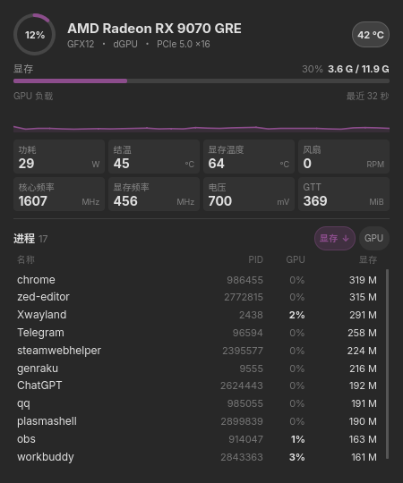

# kde-amdgpu-top

KDE Plasma 6 面板小程序：在菜单栏看 AMD GPU 的负载和显存占用，点开看传感器详情与每个进程的显存占用。

数据全部来自 [`amdgpu_top`](https://github.com/Umio-Yasuno/amdgpu_top)，不需要额外守护进程服务、不需要 root、也不需要编译 C++ 插件。




## 功能

- **面板**：`图标 + GPU 负载 + 显存占用`，显存可显示百分比或实际容量；负载 ≥70% 变黄、≥90% 变红
- **弹窗**
  - 头部：环形负载表、显卡型号、芯片代号 / 类型 / PCIe 链路、边缘温度徽标
  - 显存条：已用 / 总量 + 百分比
  - 趋势：最近 60 秒的 GFX 负载曲线
  - 传感器：功耗、结温、显存温度、风扇、核心频率、显存频率、电压、GTT
  - 进程：名称 / PID / GPU 占用 / 显存占用，可按显存或 GPU 排序
- **滚动冻结**：列表停在顶部时每秒刷新；往下滚动立刻冻结成静态表格，标题旁出现「已暂停 · 回到顶部」，点一下回到顶部并恢复实时
- **点行展开**：完整命令行、PPID、GTT、媒体引擎占用、占整卡显存百分比
- **主题跟随**：所有颜色取自 `Kirigami.Theme`，明暗配色和强调色切换即时生效，没有任何写死的颜色

## 需求

| 依赖 | 版本 | 说明 |
| --- | --- | --- |
| KDE Plasma | 6.x | 开发与测试环境：Plasma 6.8.3 / Qt 6.12 / Arch Linux |
| amdgpu_top | ≥ 0.9 | 测试版本 0.11.5；`sudo pacman -S amdgpu_top` |
| python3 | ≥ 3.8 | 只用标准库，不需要 pip 安装任何东西 |

## 安装

```bash
git clone https://github.com/haoyn231/kde-amdgpu-top.git
cd kde-amdgpu-top
./install.sh              # 装到 ~/.local/share/plasma/plasmoids/org.hao.amdgputop
./install.sh --restart    # 顺带重启 plasmashell
```

装完后：右键面板 → 进入编辑模式 → 添加小组件 → 搜索 **AMD GPU 监视器** → 拖到面板上。

开发时用软链接安装，改 QML 后重启 plasmashell 就能看到效果：

```bash
./install.sh --symlink
systemctl --user restart plasma-plasmashell.service
```

卸载：

```bash
./uninstall.sh
```

## 使用

- 点面板上的 `GPU` 数字：按 GPU 占用排序打开进程列表；点 `VRAM` 数字：按显存占用排序打开；再点一次收起
- 移动位置：右键面板 → 进入编辑模式，直接拖动（面板项现在会正确占位，不会再压住时钟）
- 弹窗里点 `显存` / `GPU` 切换排序列，再点当前列切换升/降序
- 点进程行展开详情；往下滚动会暂停刷新，回到顶部自动恢复
- 鼠标悬停面板项可以看 tooltip：负载、显存、温度、功耗、频率、amdgpu_top 版本
- 右键小组件 → 配置，可以调刷新间隔、显存显示方式、进程条数、默认排序、面板上显示哪些指标

## 数据语义

| 界面上的东西 | 来源 | 说明 |
| --- | --- | --- |
| GPU 负载 | `gpu_activity.GFX` | 来自内核 `gpu_busy_percent`，不是性能计数器 |
| 显存占用 | `VRAM.Total VRAM Usage / Total VRAM` | MiB，`amdgpu_top` 已按驱动口径换算 |
| 显存温度 / 结温 | `Sensors.Memory Temperature` / `Junction Temperature` | 部分型号没有这些传感器，缺失时显示 `—` |
| 功耗 | `Sensors.Average Power` | 整卡平均功耗 |
| 核心 / 显存频率 | `Sensors.GFX_SCLK` / `GFX_MCLK` | 实时时钟，不是峰值 |
| 进程显存 | `fdinfo.<pid>.usage.VRAM` | 该进程在 GPU 上的驻留显存（MiB） |
| 进程 GPU 占用 | `fdinfo.<pid>.usage.GFX` | 按进程统计的执行引擎占用百分比 |
| GTT | `VRAM.Total GTT Usage` | 系统内存里给 GPU 用的那部分（APU 上尤其重要） |

采样粒度：`amdgpu_top` 固定每秒吐一帧；本小程序默认每秒写一次快照、每 0.5 秒读一次，配置里最长可以放到 10 秒。

## 架构

```
amdgpu_top -J --no-pc          常驻一个进程，逐行输出 JSON（1 帧/秒）
        │
        ▼
amdgpu-topd.py                 压缩成 ~5 KB 快照 + 60 帧历史，
                               原子替换写入 $XDG_RUNTIME_DIR/kde-amdgpu-top/snapshot.json
        │
        ▼
QML（Plasma executable 数据引擎）
        ├── `python3 amdgpu-topd.py --ensure ...`   每 15 秒一次：确保守护进程在跑 + 打心跳
        └── `cat snapshot.json`                     每 0.5 秒一次：读一帧完整快照
```

几个关键取舍：

- **为什么不直接流式读 `amdgpu_top -J`？** Plasma 的 `executable` 数据引擎会把子进程输出缓冲到进程结束才一次性交付（实测 5 秒的输出会在退出时一起到达），没法做实时刷新。改成一个短命的 `cat` 每次读一份完整快照，既没有半截 JSON 的问题，也不依赖任何长连接。
- **为什么要有守护进程？** 每次刷新都新起一个 `amdgpu_top` 要重新枚举设备、解析 90 KB JSON，代价比常驻高得多。常驻 + 压缩快照后，`python3` 约占单核 0.8%，`amdgpu_top` 约 2.5%。
- **为什么不读性能计数器？** 默认带 `--no-pc`。读 GRBM 计数器可能让显卡进不了深度省电状态，而 GFX 负载来自内核计数器，不受影响。
- **进程什么时候退出？** 三个条件任一满足即退出：plasmashell 不在了、超过 90 秒没有小程序来 `--ensure`（说明小组件被移除）、收到 SIGTERM。`--ensure` 是幂等的，参数变了会自动重启旧实例。

## 配置项

| 配置 | 默认 | 说明 |
| --- | --- | --- |
| 刷新间隔 | 1 秒 | 快照写入频率（1–10 秒） |
| GPU 序号 | 0 | 机器上有多个 AMD GPU 时选第几块（`amdgpu_top --list` 的顺序） |
| 显示 GPU 图标 | 开 | 面板上是否显示图标 |
| 显示负载百分比 | 开 | |
| 显示显存占用 | 开 | |
| 显存显示为 | 百分比 | 可切换成实际容量（如 `3.8 G`） |
| 显示 GPU / VRAM 标签 | 开 | 面板拥挤时关掉可以省下约 40 px |
| 最多显示进程 | 12 | 弹窗里最多列多少行（3–40） |
| 默认排序 | 显存占用 | 显存 / GPU / 进程名 |
| 读取性能计数器 | 关 | 打开会多出 GRBM 数据，但可能影响省电 |

## 排障

```bash
# 采集进程状态 + 最近一帧的摘要
~/.local/share/plasma/plasmoids/org.hao.amdgputop/contents/scripts/amdgpu-topd.py --status

# 采集进程日志（启动失败、重启、退出原因都写在这里）
tail -f ~/.cache/kde-amdgpu-top/daemon.log

# 手工采一帧看数据对不对
~/.local/share/plasma/plasmoids/org.hao.amdgputop/contents/scripts/amdgpu-topd.py --once
```

| 现象 | 处理 |
| --- | --- |
| 弹窗显示「未找到 amdgpu_top」 | 装一下：`sudo pacman -S amdgpu_top`，然后重启 plasmashell |
| 弹窗显示「没有检测到 AMD GPU」 | 确认 `lsmod \| grep amdgpu`、`amdgpu_top --list` 有输出 |
| 数字一直不动 | 看 `--status`；如果守护进程不在，重启 plasmashell，或手动 `--ensure` |
| 面板上被裁掉一截 | 面板太挤；关掉「显示 GPU / VRAM 标签」，或去掉一个不常用的指标 |
| 加进来就挤在最右边、压住时钟 | 1.0.1 之前的问题（没给面板项声明 `Layout.*` 尺寸，Plasma 只分了图标大小的格子）。升级后重启一次 plasmashell 即可 |
| 换了 GPU 序号不生效 | 配置变更会重启守护进程，等 15 秒或重启 plasmashell |

## 开发

```
package/
  metadata.json                  Plasma 小程序元数据
  contents/
    config/main.xml              KConfig 定义（面板/弹窗的配置项）
    config/config.qml            配置对话框入口
    scripts/amdgpu-topd.py       采集守护进程（唯一的非 QML 代码）
    ui/main.qml                  数据通路：ensure / cat / 解析 / 分发
    ui/CompactRepresentation.qml 面板显示
    ui/FullRepresentation.qml    弹窗布局
    ui/ProcessList.qml           进程表 + 排序 + 滚动冻结
    ui/ProcessRow.qml            进程行 + 展开详情
    ui/RingGauge.qml             环形负载表（Canvas）
    ui/Sparkline.qml             负载趋势（Canvas）
    ui/MeterBar.qml              显存条
    ui/StatTile.qml              传感器小块
    ui/SortChip.qml              排序按钮
tools/
  preview.qml                    离屏渲染弹窗
  preview-compact.qml            离屏渲染面板项
  render-preview.sh              一键生成 docs/ 里的截图
tests/test_backend.py            build_snapshot 的单元测试（不需要显卡）
```

离屏渲染（不需要重启 plasmashell，就能看到真实排版）：

```bash
./tools/render-preview.sh          # 输出 docs/popup.png、docs/panel.png、docs/popup-error.png
```

单独渲染，方便调试布局：

```bash
QML_XHR_ALLOW_FILE_READ=1 QT_QPA_PLATFORMTHEME=KDE QT_QPA_PLATFORM=offscreen \
QT_QUICK_BACKEND=software /usr/lib/qt6/bin/qml tools/preview.qml
```

单元测试与静态检查：

```bash
python3 tests/test_backend.py
/usr/lib/qt6/bin/qmllint -I /usr/lib/qt6/qml package/contents/ui/*.qml
```

## 已知限制

- 只能看 AMD GPU —— `amdgpu_top` 的能力边界；NVIDIA / Intel 需要另外的数据源
- 进程占用是「整卡级」统计，不区分图形 / 计算 / 编解码队列
- 1 秒一次采样，适合「看一眼现在什么在吃显存」，不适合做帧级性能分析
- 面板项的宽度是固定的（约 150 px，关掉标签约 110 px），面板拥挤时需要自己取舍

## 致谢

- [amdgpu_top](https://github.com/Umio-Yasuno/amdgpu_top)：所有 GPU 数据都来自它
- [kde-perfmon](https://github.com/haoyn231/kde-perfmon)：交互与数据语义上的参照（进程列表、排序、滚动冻结）
- [DankMaterialShell](https://github.com/AvengeMedia/DankMaterialShell)：`MonitorPill` / `ProcessesView` 的刷新策略给了启发

## License

MIT，见 [LICENSE](LICENSE)。
