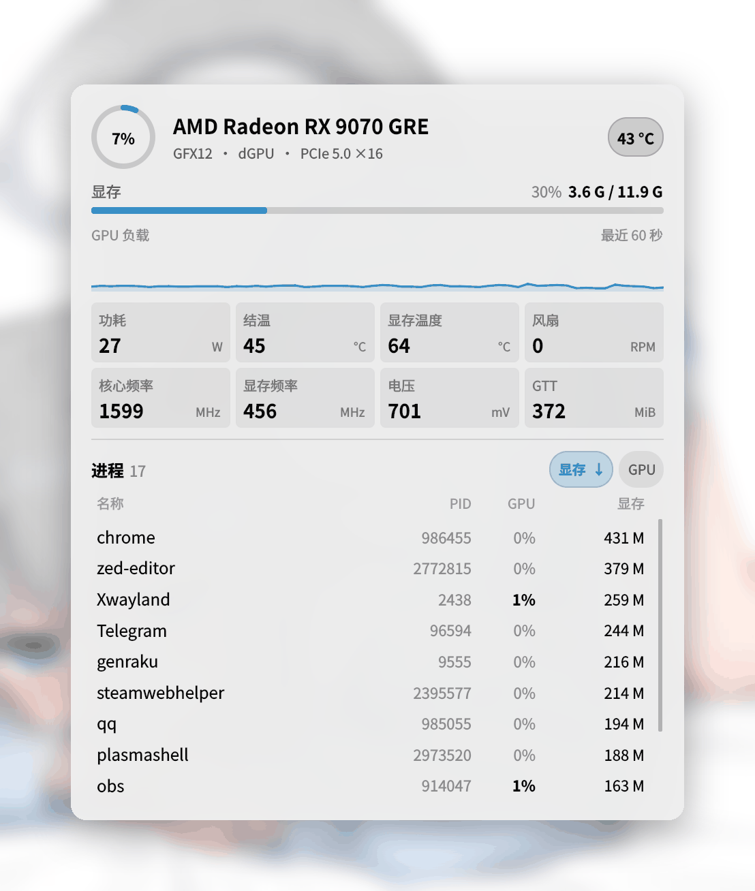

<div align="center">
  <h1 align="center">kde-amdgpu-top</h1>
  <p align="center">KDE Plasma 6 面板监视器：AMD GPU 负载 / 显存预览、传感器详情与进程占用</p>
  <p align="center"><a href="README.en.md">English</a> | 中文</p>

  <a href="https://github.com/haoyn231/kde-amdgpu-top/releases/latest"></a>
  <a href="./LICENSE"></a>
  
  
  
  
  <br>
  <a href="https://github.com/haoyn231/kde-amdgpu-top/stargazers"></a>
</div>

---

<p align="center">
  
</p>

<p align="center"><sub>环形负载表、显存条、60 秒趋势、8 个传感器小块，以及按显存排序的进程列表</sub></p>

KDE Plasma 6 面板小程序（Plasmoid）：在菜单栏预览 AMD GPU 的负载与显存占用，点开后查看传感器详情与每个进程的显存占用，并可按显存或 GPU 占用排序。数据全部来自 [`amdgpu_top`](https://github.com/Umio-Yasuno/amdgpu_top)，配色完全跟随系统明暗主题。

实现参考了 [kde-perfmon](https://github.com/haoyn231/kde-perfmon) 的 `CompactRepresentation` / 进程列表交互与数据语义，以及 [DankMaterialShell (DMS)](https://github.com/AvengeMedia/DankMaterialShell) 的列表刷新策略。与 kde-perfmon 不同的是：这里不做 C++ 插件编译，面板与弹窗是纯 QML，采集交给一个 Python 脚本。

## 功能

- 面板中显示「图标 + GPU 负载 + 显存占用」，显存可显示百分比或实际容量；负载 ≥70% 变黄、≥90% 变红
- 点击 GPU 数字：按 GPU 占用打开进程列表；点击 VRAM 数字：按显存占用打开；再点一次关闭
- 弹窗头部：环形负载表、显卡型号、芯片代号 / 类型 / PCIe 链路、边缘温度徽标
- 显存条：已用 / 总量 + 百分比，接近上限时转为警示色
- 趋势：最近 60 秒的 GFX 负载曲线（历史由采集进程累积，打开弹窗就能看到完整曲线）
- 传感器：功耗、结温、显存温度、风扇转速、核心频率、显存频率、电压、GTT
- 进程行：名称、PID、GPU 占用、显存占用；`显存` / `GPU` 两个排序按钮，再点当前按钮切换升/降序
- 点击进程行展开完整命令行、`PPID`、GTT、媒体引擎占用与占整卡显存百分比
- 列表只在滚动到最顶上时实时刷新；一旦向下滚动就冻结成静态表格，标题旁显示 `已暂停 · 回到顶部`，点一下回到顶部并恢复实时
- 弹窗关闭时不重建进程表，采集进程只写快照，开销降到最低
- 全部颜色绑定 `Kirigami.Theme`，明暗配色与强调色切换即时生效

## 安装（KDE Plasma 6）

### 方式一：从 Release 安装（推荐）

Release 包是**纯 QML + Python 脚本**，没有需要编译的二进制，普通用户不需要安装编译工具。

1. 系统要求：KDE Plasma 6（Qt 6.5+）、[`amdgpu_top`](https://github.com/Umio-Yasuno/amdgpu_top)（≥ 0.9）、`python3`（只用标准库）。发布包在 Arch Linux / Plasma 6.8.3 / Qt 6.12 / amdgpu_top 0.11.5 上测试。
2. 从 [Releases](https://github.com/haoyn231/kde-amdgpu-top/releases) 下载 `kde-amdgpu-top-vX.Y.Z.tar.gz` 和对应的 `.sha256` 文件，并校验：
   ```bash
   sha256sum -c kde-amdgpu-top-v0.1.1.tar.gz.sha256
   ```
3. 解压到当前用户的 Plasma 小程序目录：
   ```bash
   mkdir -p ~/.local/share/plasma/plasmoids
   tar -xzf kde-amdgpu-top-v0.1.1.tar.gz -C ~/.local/share/plasma/plasmoids
   ```
   解压后应存在：
   ```
   ~/.local/share/plasma/plasmoids/org.hao.amdgputop/metadata.json
   ~/.local/share/plasma/plasmoids/org.hao.amdgputop/contents/scripts/amdgpu-topd.py
   ~/.local/share/plasma/plasmoids/org.hao.amdgputop/contents/ui/main.qml
   ```
   采集脚本需要可执行位；如果解压后丢失了权限，补一下：
   ```bash
   chmod +x ~/.local/share/plasma/plasmoids/org.hao.amdgputop/contents/scripts/amdgpu-topd.py
   ```
4. 让 Plasma 重新加载小程序（首次安装通常已经能识别，升级后建议执行）：
   ```bash
   systemctl --user restart plasma-plasmashell.service
   ```
   也可以注销后重新登录。
5. 添加小组件：右键面板 → **进入编辑模式**（或「添加小组件」）→ 搜索 **AMD GPU 监视器** / **AMD GPU Monitor** → 拖到面板上。
6. 点击面板中的 GPU 数字或显存数字，即可打开详情。

如果弹窗提示「未找到 amdgpu_top」，先装上它（Arch）：

```bash
sudo pacman -S amdgpu_top
```

卸载：
```bash
rm -rf ~/.local/share/plasma/plasmoids/org.hao.amdgputop
systemctl --user restart plasma-plasmashell.service
```

### 方式二：从源码安装

依赖（Arch Linux）：

```bash
sudo pacman -S --needed plasma-desktop amdgpu_top python
```

安装到当前用户：

```bash
git clone https://github.com/haoyn231/kde-amdgpu-top.git
cd kde-amdgpu-top
./install.sh
systemctl --user restart plasma-plasmashell.service
```

开发时改用软链接安装，改完 QML 重启 plasmashell 就能看到效果：

```bash
./install.sh --symlink
```

然后按「方式一」的第 5 步把「AMD GPU 监视器」添加到面板。

## 使用

- 面板中的两个数字分别是 GPU 负载与显存占用。
- 点击 GPU 数字会先按 GPU 占用排序再打开；点击显存数字会先按显存排序再打开。
- 弹窗打开后，再次点击面板上的数字即可关闭。
- 移动位置：右键面板 → 进入编辑模式，直接拖动（面板项会正确占位，不会压住相邻的时钟或托盘）。
- 弹窗内：
  - 点击 `显存` / `GPU` 切换排序列；
  - 再次点击当前列，切换升序 / 降序；
  - 鼠标滚轮与触控板滚动都可以滚动进程列表。
- 列表的实时刷新只在最顶端生效：
  - 停在最顶上时每秒刷新，数值一直在动；
  - 一旦向下滚动，表格立即冻结，标题旁出现 `已暂停 · 回到顶部` 提示，此时总览与传感器仍然每秒更新；
  - 点击该提示回到顶部，自动恢复实时刷新；
  - 冻结期间切换排序列也会回到顶部并重新进入实时状态。
- 点击进程行展开 / 折叠：
  - 展开后显示完整命令行、`PPID`、`GTT`、媒体引擎占用与占整卡显存百分比；
  - 进程已退出、命令行不可读时会给出提示。
- 右键小组件 → 配置，可以调刷新间隔、显存显示方式、进程条数、默认排序、面板上显示哪些指标。

## 数据语义

数据全部来自 `amdgpu_top` 的 `-J` 输出；界面侧只读一份约 5 KB 的快照：

| 界面上的数字 | 来源字段 | 说明 |
| --- | --- | --- |
| GPU 负载 | `gpu_activity.GFX` | 内核 `gpu_busy_percent`，不是性能计数器 |
| 显存占用 | `VRAM.Total VRAM Usage` / `Total VRAM` | MiB，按驱动口径换算 |
| 显存温度 / 结温 | `Sensors.Memory Temperature` / `Junction Temperature` | 部分型号没有这些传感器，缺失时显示 `—` |
| 功耗 | `Sensors.Average Power` | 整卡平均功耗 |
| 核心 / 显存频率 | `Sensors.GFX_SCLK` / `GFX_MCLK` | 实时时钟，不是峰值 |
| 电压 | `Sensors.VDDGFX` | mV |
| GTT | `VRAM.Total GTT Usage` | 系统内存里给 GPU 用的那部分（APU 上尤其重要） |
| 进程显存 | `fdinfo.<pid>.usage.VRAM` | 该进程在 GPU 上的驻留显存 |
| 进程 GPU 占用 | `fdinfo.<pid>.usage.GFX` | 按进程统计的执行引擎占用百分比 |

排序规则与 kde-perfmon 一致：切换列时从降序开始，再点同一列切换方向；数值相同时按 PID 升序。

### 刷新与冻结

- 采集进程每秒把最新一帧压成快照（约 5 KB），用原子替换写入 `$XDG_RUNTIME_DIR/kde-amdgpu-top/snapshot.json`。
- 界面每 0.5 秒读一次快照；时间戳相同的帧直接丢弃，不触发重绘。
- 弹窗打开时，进程表每秒按当前排序列重建一次；数据没变时跳过重建（用 pid + 显存 + GPU 组成的签名判断）。
- 向下滚动即冻结模型重建；回到顶部后重新建立刷新。
- 弹窗关闭后只更新面板上的两个数字，不再重建进程表。

### 采集与开销

- 整条链路只常驻一个 `amdgpu_top -J --no-pc` 子进程，不会反复启动它。
- `python3` 采集进程约占单核 0.8%，`amdgpu_top` 约占 2.5%（实测 RX 9070 GRE / 24 线程）。
- 默认带 `--no-pc`：不读 GRBM 性能计数器，避免影响显卡的省电策略；GFX 负载来自内核计数器，不受影响。
- 采集进程有三条退出条件：plasmashell 不在、超过 90 秒没有小程序来 `--ensure`（说明小组件已被移除）、收到 SIGTERM。不会留下孤儿进程。

## 主题

没有写死任何前景色或背景色：

- 文字：`Kirigami.Theme.textColor`，次要信息由 `textColor` 派生低透明度叠加
- 卡片、传感器小块、排序按钮底色：同样由 `textColor` 派生
- 强调色：`Kirigami.Theme.highlightColor`（跟随 KDE 强调色）
- 高负载阈值：`neutralTextColor` / `negativeTextColor`
- 环形表与趋势图用 Canvas 绘制，主题色变化时主动重绘

已在运行期间从 `OrchisDark` 切换到 `BreezeLight` 并切回，界面颜色即时更新；`docs/images/screenshot.png` 是深色主题下的离屏渲染结果。

## 开发与测试

```bash
# 单元测试（不需要显卡，也不需要 amdgpu_top）
python3 tests/test_backend.py

# QML 静态检查（Arch 上 Qt6 版位于 /usr/lib/qt6/bin/qmllint）
/usr/lib/qt6/bin/qmllint -I /usr/lib/qt6/qml package/contents/ui/*.qml

# 不依赖面板，直接把真实弹窗 QML 渲染成 PNG（同时输出面板项与错误态）
./tools/render-preview.sh
```

`tools/render-preview.sh` 会先复制一份运行中的快照（没有就现场采一帧），再离屏渲染出 `docs/images/` 里的三张图。也可以单独渲染调试布局：

```bash
QML_XHR_ALLOW_FILE_READ=1 QT_QPA_PLATFORMTHEME=KDE QT_QPA_PLATFORM=offscreen \
QT_QUICK_BACKEND=software /usr/lib/qt6/bin/qml tools/preview.qml
```

本地打包 Release 资产（生成 `dist/kde-amdgpu-top-vX.Y.Z.tar.gz` 与 `.sha256`，并顺带跑一遍单测和 `qmllint`）：

```bash
./tools/build-release.sh
```

目录结构：

```
package/
  metadata.json             Plasma 小程序元数据
  contents/config/          main.xml + 配置对话框入口
  contents/scripts/         amdgpu-topd.py（采集守护进程，唯一的非 QML 代码）
  contents/ui/              main / 面板 / 弹窗 / 进程表 / 进程行 / 环形表 / 趋势图 …
tests/test_backend.py       build_snapshot 的单元测试 + 实机采样断言
tools/preview.qml           离屏渲染弹窗
tools/preview-compact.qml   离屏渲染面板项
tools/render-preview.sh     一键生成 docs/images 里的截图
tools/build-release.sh      本地打包 Release 资产
docs/releases/              每个版本的 Release 文档与通用模板
install.sh / uninstall.sh   源码安装与卸载
```

当前没有 CI：Release 资产在本地用 `tools/build-release.sh` 打包，再手动上传。

## 常见问题

- **弹窗显示「未找到 amdgpu_top」**：装一下 `amdgpu_top`，然后重启 plasmashell。
- **弹窗显示「没有检测到 AMD GPU」**：确认 `lsmod | grep amdgpu` 有输出、`amdgpu_top --list` 能列设备。
- **数字一直不动**：看采集进程状态 `~/.local/share/plasma/plasmoids/org.hao.amdgputop/contents/scripts/amdgpu-topd.py --status`，日志在 `~/.cache/kde-amdgpu-top/daemon.log`。
- **面板上被裁掉一截**：面板太挤，关掉「显示 GPU / VRAM 标签」或去掉一个不常用的指标。
- **多块 AMD GPU**：在配置里改「GPU 序号」，序号对应 `amdgpu_top --list` 的顺序。

## License

MIT，见 [LICENSE](LICENSE)。

KDE Plasma 6 panel widget: AMD GPU load and VRAM usage in the panel, with sensor details and per-process VRAM usage in the popup. All data comes from `amdgpu_top`.
